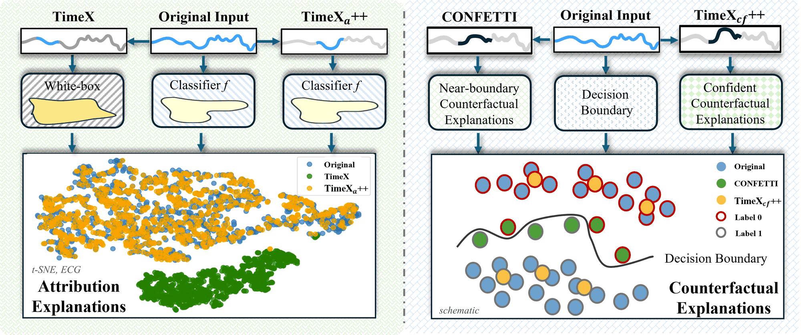
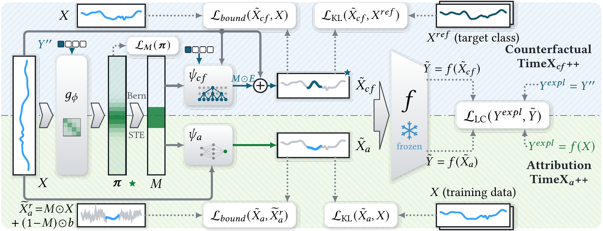

# TimeX++: Towards A Unified Information Bottleneck Framework for Time Series Explanations

[](https://arxiv.org/abs/2608.25897)
[](LICENSE)

Official code of [*Towards A Unified Information Bottleneck Framework for Time Series Explanations*](https://arxiv.org/abs/2608.25897), the extension of our ICML 2024 paper *TimeX++: Learning Time-Series Explanations with Information Bottleneck*.
The repository trains and evaluates both explainers:

- **TimeX++-a (attribution).** A stochastic mask over time steps and channels, trained so that the generated instance keeps the black-box prediction. This is the explainer of the ICML paper.
- **TimeX++-cf (counterfactuals).** An editor that changes the prediction to a chosen target class while modifying only the coordinates inside a learned mask. The default editor is temporal and target-conditioned: one model covers all target classes and needs a single forward pass at inference.

Both explainers share one mask-based objective template inspired by the Information Bottleneck principle. Our implementation builds on [TimeX](https://github.com/mims-harvard/TimeX); the attribution code of the conference version is at [zichuan-liu/TimeXplusplus](https://github.com/zichuan-liu/TimeXplusplus).

## Overview



*Figure 1. The two explanation types. Left: t-SNE (ECG) of the instances on which the classifier is queried during attribution. TimeX queries a retrained white-box surrogate with masked inputs, whereas TimeX++-a queries the classifier f itself with generated instances. Right (schematic, not computed from data): a counterfactual that lies close to the decision boundary versus one that edits only the masked segment and lies further inside the target class.*



*Figure 2. The two explainers share one template and one frozen classifier f. A mask extractor g<sub>φ</sub> maps the input X to selection probabilities π, and a binary mask M ~ Bern(π) is sampled with a straight-through estimator (STE). TimeX++-cf (top) receives a target class Y″, which is also an input of g<sub>φ</sub> and of the temporal editor ψ<sub>cf</sub>, and adds the edit only at the masked coordinates, X̃<sub>cf</sub> = X + M ⊙ E. TimeX++-a (bottom) forms X̃<sub>a</sub> with a per-coordinate generator ψ<sub>a</sub>. The label-consistency loss L<sub>LC</sub> compares the prediction of f with the target Y″, so that the prediction changes, or with the original prediction f(X), so that it is preserved. The two explainers have separate parameters and are trained separately.*

## Repository layout

```
txai/                          library
  models/bc_model.py             TimeX++-a (TimeXModel)
  models/bc_model_cf.py          TimeX++-cf with the local, coordinate-wise editor
  models/bc_model4.py            TimeX (baseline, used when is_timex=True)
  trainers/                      training loops
  utils/, synth_data/, baselines/  data loaders, metrics, synthetic generators, attribution baselines from TimeX
timesynth-0.2.4/               TimeSynth, needed by the synthetic data loaders
experiments/
  <dataset>/                   per-dataset scripts
    train_transformer.py         black-box classifier (train_cnn.py / train_lstm.py where used)
    bc_model_ptype.py            TimeX++-a (set is_timex=True for the TimeX baseline)
    bc_model_ptype_cf.py         TimeX++-cf, local editor, targeted
    bc_model_ptype_cf_untargeted.py
  evaluation/                  attribution evaluation scripts from TimeX (ground-truth AUPRC/AUP/AUR, occlusion)
  unified/                     one protocol for both explainers on all datasets
    common.py                    dataset configurations, data loading, model builders, CF trainer, evaluators
    main_jobs.sh                 job lists for the main results (below)
    run_queue.py                 minimal GPU job queue
    train_attr.py                TimeX++-a (+ cache of the mask probabilities)
    aggregate_attr.py            attribution rows (mean and standard error over splits)
    occlusion_real.py            occlusion check on real data without ground truth (Epilepsy, PAM)
    train_cf.py                  TimeX++-cf with the temporal editor (TemporalEditor, CFTemporal, train_cf_cond)
    untargeted_cf.py             untargeted counterfactuals
    aggregate_cf.py              targeted CF rows (incl. PAM)
    train_cf_local.py            TimeX++-cf with the local editor, and the mask-source control
    aggregate_cf_local.py        CF rows of the local editor
    train_cf_variants.py         temporal editor with nested masks, loss ablations, CNN/LSTM black boxes, prior r
    analyze_cf.py                noise robustness, mask-probability histograms, generation time
    score_cf.py, oracles.py      CF scoring (validity, sparsity, proximity, transfer, semantic validity)
    robust_cf.py, leakage.py, ood.py   robustness of CFs, generator leakage, distance of queries from the data
    local_editor_jobs.sh, analysis_jobs.sh   job lists of the local-editor runs and of the further analyses
```

Dataset folders: `freqshape` (FreqShapes), `scs_better` (SeqComb-UV), `seqcomb_mv` (SeqComb-MV), `lowvardetect` (LowVar), `mitecg_hard` (ECG), `epilepsy`, `PAM`, `Boiler`. The scripts in `experiments/unified/` use the keys `freqshape`, `seqcomb_uv`, `seqcomb_mv`, `lowvar`, `mitecg`, `epilepsy`, `pam`.

## Setup

Python 3.12, PyTorch 2.4.

```shell
pip install -r requirements.txt
pip install ./timesynth-0.2.4
pip install -e .
```

## Data

Put the datasets in `datasets/` at the repository root:

| folder | source |
| --- | --- |
| `FreqShape`, `SeqCombSingle`, `LowVarDetect`, `MITECG`, `Epilepsy`, `PAM`, `Boiler` | TimeX datasets, [Harvard Dataverse](https://doi.org/10.7910/DVN/B0DEQJ) |
| `SeqCombMV2` | [Google Drive](https://drive.google.com/file/d/1k3487vs9iEw3y1neOWMRwuUGmAHDvIof/view?usp=drive_link) |

Each folder holds five splits (`split=<k>.pt`, or the dataset's own split files).

## Reproducing the main results

**1. Black-box classifiers.** For each dataset:

```shell
python experiments/<dataset>/train_transformer.py      # saves experiments/<dataset>/models/*_split=<k>.pt
```

`experiments/freqshape`, `seqcomb_mv` and `mitecg_hard` also have `train_cnn.py` / `train_lstm.py` for the CNN and LSTM black boxes. The file names the explainers load are listed in `experiments/unified/common.py` (`DS[...]['bb' | 'cnn' | 'lstm']`).

Note: `experiments/mitecg_hard/train_*.py` and `experiments/epilepsy/train_transformer.py` wrap the training set in `txai.utils.data.preprocess.EpiDataset`, whose `__len__` returns the sequence length rather than the number of windows, so each epoch uses only the first T training windows (360 for ECG, 178 for Epilepsy). The main results of the paper explain these classifiers; the supplementary material repeats the affected experiments with classifiers retrained on all windows.

**2. Both explainers, five splits per dataset.**

```shell
cd experiments/unified
bash main_jobs.sh                                          # writes jobs_main_train.txt, jobs_main_eval.txt
python run_queue.py jobs_main_train.txt --gpus 0,1 --per_gpu 2
python run_queue.py jobs_main_eval.txt  --gpus 0   --per_gpu 1
```

Single runs (from `experiments/unified`):

```shell
# TimeX++-a
python train_attr.py --ds freqshape --split 1            # -> results/e0/freqshape_split=1.json (AUPRC/AUP/AUR)
python aggregate_attr.py                                 # -> results/attr_rows.json

# TimeX++-cf, temporal editor (one model for all targets)
python train_cf.py --ds freqshape --split 1 --variant cond --max_epochs 300 --patience 45 --restarts 2 --nsamples 5
python untargeted_cf.py --ds freqshape --splits 1
python aggregate_cf.py                                   # -> results/C1_temporal/table4.csv
```

The CF metrics are validity, target-class confidence, sparsity (fraction of modified coordinates) and proximity (L1 / L2, overall and on valid counterfactuals). They are computed per (split, target) and aggregated as in the paper. Checkpoints, caches, logs and results are written to `experiments/unified/{ckpt,cache,logs,results}`.

**Local (coordinate-wise) editor.** The per-target editor is in `experiments/<dataset>/bc_model_ptype_cf.py` (per-dataset scripts) and in `experiments/unified/train_cf_local.py --variants learned --main` (see `local_editor_jobs.sh`). When these runs exist, `aggregate_cf.py` also reports paired comparisons of the two editors.

**Further analyses.** `analysis_jobs.sh` writes the job lists of the nested-mask variant, the loss ablations (`--abl no_ste|no_bound|no_kl|no_con|no_lc`), the mask-source control, the prior-r sweep and the CNN/LSTM black boxes (`--arch`). `analyze_cf.py --part robust|pi|timing` measures noise robustness, mask-probability histograms and generation time; these parts also read the local-editor outputs (`results/robust_cf`, `results/e2`, `ckpt/<ds>/main`).

## Notes

- The distribution term is the learned Gaussian KL of the conference code (`TIMEX_DIST=kl`, the default). `TIMEX_DIST=mmd` switches to a fixed-kernel MMD and writes to separate `*_mmd` folders.
- Table numbers mentioned in script docstrings may not match the numbering of the paper.
- Scripts that queue jobs use `$PY` (default `python`) as the interpreter.
- Counterfactual baselines (CoMTE, AB-CF, M-CELS, CONFETTI, SPARCE, ...) are run from their official repositories and are not included here.

## Citation

If you find this code useful, please cite:

```bibtex
@article{zheng2026towards,
  title   = {Towards A Unified Information Bottleneck Framework for Time Series Explanations},
  author  = {Zheng, Xu and Liu, Zichuan and Chen, Zhuomin and Akewar, Mayur and Bhimani, Janki and Liu, Jason and Sha, Mo and Ni, Jingchao and Cheng, Wei and Luo, Dongsheng},
  journal = {arXiv preprint arXiv:2608.25897},
  year    = {2026}
}

@inproceedings{liu2024timex,
  title     = {TimeX++: Learning Time-Series Explanations with Information Bottleneck},
  author    = {Liu, Zichuan and Wang, Tianchun and Shi, Jimeng and Zheng, Xu and Chen, Zhuomin and Song, Lei and Dong, Wenqian and Obeysekera, Jayantha and Shirani, Farhad and Luo, Dongsheng},
  booktitle = {Proceedings of the 41st International Conference on Machine Learning},
  year      = {2024}
}
```

## License

This repository is released under the [MIT License](LICENSE). Bundled third-party code keeps its own terms: `timesynth-0.2.4/` (TimeSynth, MIT), the baselines in `txai/baselines/` (Dynamask, FIT, SGT), and the parts of `txai/` and `experiments/` adapted from [TimeX](https://github.com/mims-harvard/TimeX).
